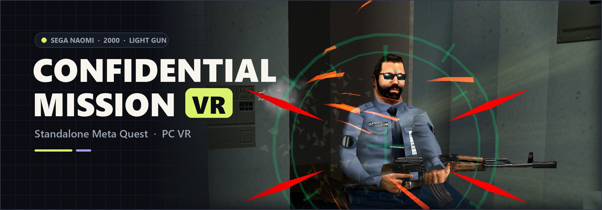
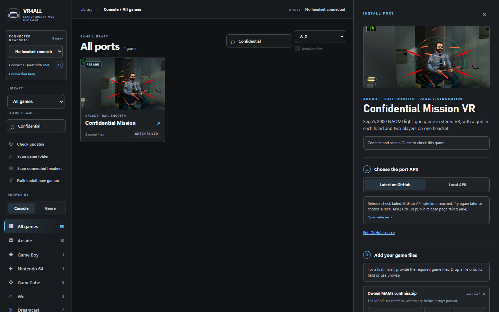

<div align="center">



# Confidential Mission VR
### Sega's NAOMI Light-Gun Game in VR · Standalone Meta Quest & PC VR

[-brightgreen?style=for-the-badge)](../../releases)
[-blue?style=for-the-badge)](#install-on-the-quest)
[-orange?style=for-the-badge)](#what-you-need)

**[⬇️ Download the Quest APK](../../releases/latest/download/confidential-mission-vr-quest.apk)** • **[🖥️ PC VR zip](../../releases/latest/download/confidential-mission-vr-pcvr.zip)** • **[🎮 Controls](#controls)**

**[🌐 VR4ALL - Standalone VR Mod Installer](https://github.com/vr4all-standalone/vr4all-standalone)**

</div>

---

## 🕵️ Overview

**Confidential Mission VR** puts you inside Sega's 2000 arcade light-gun game **Confidential
Mission** (Sega NAOMI), on a **Meta Quest** with no PC, or on a **PC VR** headset. The original
game runs in an emulator, its 3D scenes are rebuilt around you in stereo, and your controller is
the light gun. Up to two players, a gun in each hand.

It is built on **[mikermak's VR fork of Flycast](https://github.com/mikermak/hotd2-vr)**: the VR
mode, the panel the start screen grew from and the tools are his work, and much of this readme
is too. His fork is itself built on the [Flycast](https://github.com/flyinghead/flycast)
Dreamcast and NAOMI emulator. There is no remake here: the original game runs, and the emulator turns what it
draws into a VR view.

> **⚖️ No game included.** An unofficial fan project, not affiliated with or endorsed by Sega,
> Namco, Meta or the Flycast project. The apps contain no Sega code, data, graphics or sound,
> and neither does this repository, apart from the banner above (a screenshot of the game,
> © SEGA): you need your own copy of the game, the MAME set `confmiss`.

Status: experimental. Made for the Quest 3 and played on it; Quest 3S, Quest 2, Quest Pro and
PC VR headsets are not tested yet (see [The game](#the-game)).

---

## ✨ Key VR Features

* **Stereoscopic 3D, Wider Than the Arcade:** The game's 3D scenes stand around you at real
  scale, and the game itself draws a wider view: stage 1 opens up from about **61° × 48°** to
  **111° × 95°**. The HUD, subtitles and mission briefings sit on a panel in front of you.
* **Your Controller Is the Light Gun:**
  * **Three guns:** the agents' own pistol, made on the first start from your copy of the game
    (nothing of the game comes with the app), the **Arcade gun** or the **Nintendo Zapper**. Or
    bring your own **GLB** models.
  * **The assault rifle with any gun:** pick it up and the gun in your hand fires its bursts.
  * **Gun angle:** tilt the gun from **-30° to +30°**, so it points where your hand points,
    whatever controller you hold.
* **Recoil & Haptics That Match the Game:**
  * **Kick, muzzle flash and knock** only when the game really fires a round: one for every
    round of a rifle burst, a light click on an empty gun, nothing on a reload.
  * **Haptics Off, Light, Medium or Strong**, from the menu.
* **Two Players, One Headset:** Player 2 presses Start on the other controller (**Left `X`**)
  and joins, both lives and scores on screen. With two players, **player 1 is on the left hand
  and player 2 on the right** by default, matching the game's screen (the menu's **Two players**
  row turns it round). Playing alone, either hand's trigger takes the gun.
* **Arcade Reloads, or Not:** Shoot away from the game's view as at the arcade, or just point
  away (the menu's **Reload** row). **`B`** and **`Y`** reload too.
* **Empty Hands in the Cutscenes:** In the stage intros and story scenes your hands are empty
  (no gun, no controller, no laser). The guns come back the moment play resumes, and **Start**
  skips the scene.
* **A Pause Menu in the Headset:** The **Left `≡`** button pauses the game: gun, gun angle,
  reload, two players' hands, laser, haptics, world size, panel distance and a how-to-play view, each saved
  at once.
* **A Start Screen That Checks Your Files:** **READY**, or exactly which file is missing and
  where it goes.
* **Standalone Quest & PC VR:** It runs on the **Quest** itself, no PC needed, or on a **PC VR**
  headset through SteamVR, Quest Link / Air Link or Virtual Desktop.

---

## 🎮 Quest Touch Controller Layout

| Action | Quest Touch controller |
| :--- | :--- |
| **Shoot** | **Trigger**: alone, either hand (the gun goes to the hand that fires) · two players: left hand player 1, right hand player 2 |
| **Start / join** | **Right `A`** player 1 · **Left `X`** player 2 joins · two players: **`X`** player 1, **`A`** player 2 |
| **Reload** | alone, **`B`** or **`Y`** · two players: **Left `Y`** player 1, **Right `B`** player 2 · or shoot away from the view |
| **Settings menu (pauses)** | **Left `≡` Menu** button |
| **Recenter** | **Left thumbstick click** *or* hold the **Meta** button |
| **Laser off / on** | **Right thumbstick click** |
| **The game's D-pad (its menus)** | **Thumbstick** |
| **World size** | Hold **Grip** + push the **Thumbstick up / down** |
| **Gun size** | Hold **Grip** + push the **Thumbstick left / right** |

Everything else, the PC VR controllers (Index, Vive, Windows Mixed Reality) and the menu's
rows: [Controls](#controls) and [The menu](#the-menu).

---

<a id="install-on-the-quest"></a>
## 📦 Installation (Meta Quest)

For Quest 3, 3S, 2 and Pro (Quest 3S, 2 and Pro: not tested yet, tell me how it runs).

> **⭐ The easiest way: [VR4ALL](https://github.com/vr4all-standalone/vr4all-standalone)** installs
> the app and copies your game files in one go ([step 2](#2-install-with-vr4all-the-best-way)).

<a id="what-you-need"></a>
### What you need

Your own copy of the game: the MAME set `confmiss`, three files.

| File | What it is |
| :--- | :--- |
| `confmiss.zip` | the game, with its key inside (it stays packed) |
| `confmiss/gds-0001.chd` | the disc, in a folder named `confmiss` next to `confmiss.zip` (a `.cue` or `.gdi` of it works too) |
| `naomi.zip` | the NAOMI BIOS, next to `confmiss.zip` (or the BIOS inside `confmiss.zip`) |

On the Quest they go in the headset's Download folder:

```
Download/
    confmiss.zip
    confmiss/gds-0001.chd
    naomi.zip
```

### 1. Developer mode

Make a (free) developer account at [developers.meta.com](https://developers.meta.com/horizon/)
with your Meta account, then in the Meta Horizon app on your phone: Devices > your headset >
Headset settings > Developer mode. Restart the headset.

### 2. Install with VR4ALL (the best way)

**[VR4ALL](https://github.com/vr4all-standalone/vr4all-standalone) is the best way to install
Confidential Mission VR.** It's a free PC app that installs standalone Quest VR mods: connect the
headset by USB, pick **Confidential Mission VR** in its library and drop in your three files.
VR4ALL downloads the latest APK from this project's Releases, installs it, gives the app its
file access and copies your files to the right folders on the headset, so step 3 is done too.

<p align="center">
  
</p>

**Or by hand:** download **`confidential-mission-vr-quest.apk`** from [**Releases**](../../releases)
and install it with **[SideQuest](https://sidequestvr.com/setup-howto)** (*Install APK file from
folder*) or ADB:

```bash
adb install -r confidential-mission-vr-quest.apk
adb shell appops set com.vrlightgunhub.confmiss MANAGE_EXTERNAL_STORAGE allow
```

The second line gives the app its *All files access* now, so it can read the Download folder;
without it, the start screen asks for it the first time.

### 3. Copy your game files

VR4ALL did this for you in step 2. By hand: copy your three files to the headset's **Download**
folder, as in [What you need](#what-you-need), with SideQuest (*Manage files*), or connect the headset to a PC with USB, allow access
in the headset, and open *Quest > Internal shared storage > Download*.

### 4. Play

Start *Confidential Mission VR* from your Library (*Unknown sources*). Its start screen checks
the three files: its badge says READY (in green) when all three are there, MISSING FILES with a
line for each one that isn't, or ALLOW ACCESS until the app may read the Download folder.
*Play Confidential Mission* starts the game in VR, and is greyed out until then. *Where to put
your files* opens the instructions and the access step (*Allow*: *All files access*, the first
time) and *Look again* checks once more. The first start makes your guns from your own game
files, once (about a minute or two; B skips it, with the Arcade gun that time).

Updates install over the old version; settings and saves stay.

**Had VR Light Gun Hub 0.1.0 on the headset?** Confidential Mission VR is a separate app
(`com.vrlightgunhub.confmiss`, with fresh settings) and installs next to it: uninstall the hub
(`com.vrlightgunhub.app`).

---

## 🖥️ PC VR

The same, on a PC with a VR headset: SteamVR, Quest Link / Air Link or Virtual Desktop
(anything with an OpenXR runtime that does OpenGL). Not tested yet on every one of them:
tell me how it goes.

1. Download `confidential-mission-vr-pcvr.zip` from [Releases](../../releases) and unpack it
   anywhere.
2. Make a folder `roms` next to `flycast.exe` and put the three files in it:
   `roms\confmiss.zip`, `roms\confmiss\gds-0001.chd` and `roms\naomi.zip`.
3. Connect the headset (start SteamVR, Quest Link or Virtual Desktop) so it is the active
   OpenXR runtime.
4. Double-click `Play Confidential Mission.cmd`. It starts `flycast.exe` on
   `roms\confmiss.zip`: the game plays in the headset, and the window stays as it was.

Controllers: see [Controls](#controls). Settings: `emu.cfg` next to `flycast.exe` (`vr.Xr = yes`
turns VR on; without a headset the game plays in the window).

If the world looks the wrong size, set `vr.WorldScale = 0.11` in `emu.cfg` (the default) and
adjust from there.

---

<a id="controls"></a>
## 🕹️ Controls

Quest Touch:

| Button | Does |
|---|---|
| A | Start, player 1 (with two players in: player 2's Start) |
| B | reload, player 1 (with two players in: player 2's reload) |
| X | Start, player 2: player 2 joins, a gun in each hand (with two players in: player 1's Start) |
| Y | reload, player 1, as B (with two players in: player 1's reload) |
| ≡ (left menu button) | opens or closes the settings menu |
| left thumbstick click | recenter |
| right thumbstick click | laser off/on (kept) |
| trigger | shoot |
| grip + thumbstick up/down | world size (kept) |
| thumbstick | the game's D-pad (menus) |

The two-player meanings are the menu's Two players at its default, "P1 left / P2 right"; at "P1 right / P2 left" the right controller's buttons stay player 1's and the left's player 2's.

The how-to-play labels by the controllers' buttons (before play starts, and the menu's How to play while you play alone):
- right controller: A - P1 Start · B - P1 Reload · Trigger - P1 Shoot · Stick - Laser
- left controller: X - P2 Start · Y - P2 Reload · Trigger - P2 Shoot · Stick - Recenter · Menu

With two players in, the menu's How to play shows them as they are then (P1 on the left, the default):
- left controller: X - P1 Start · Y - P1 Reload · Trigger - P1 Shoot · Stick - Recenter · Menu
- right controller: A - P2 Start · B - P2 Reload · Trigger - P2 Shoot · Stick - Laser

"Stick" is the stick click. Before player 2 joins, the left trigger shoots for player 1 too: the
one gun goes to the hand that fires.

In the game's cutscenes (the stage intros and the story scenes) both hands are empty: no gun,
no controller, no laser. The guns come back the moment play resumes. Start still skips
a scene. A round the game fires during one (a scene that takes shots) brings the guns back at
once, until the scene ends.

Reload by shooting away from the game's view (past the grey ring), as before; with two guns,
pointing a gun at the floor reloads it too. With the menu's Reload at Point off-screen, pointing
the gun away from the game's view is enough: it reloads once, with a short buzz, each time it
leaves (not into the grey ring, not with a full gun, not from the menu). B and Y are the cabinet's second button, the game's
own reload: with one gun either reloads it, with two guns B reloads the right one and Y the
left one. Grip + thumbstick left/right sizes the gun (kept). The gun goes to the hand you last
fired with.

The knock in the hand comes when the game fires, one for each shot it counts; a pull on an
empty gun gives a light click instead, and a reload none. `vr.Haptics` sets how strong it is.
The gun kicks and flashes only when the game fires a round too: never on a pull on an empty
gun or a reload, and still with `vr.Haptics` off.
With the assault rifle (shoot one a fallen enemy drops) the trigger held keeps firing: a sharp
knock for the first bullet, then a short lighter one for each bullet after, 12 a second, each
with a small kick and its flash.

**Two guns.** Press X and player 2 joins, as at the cabinet, both lives and scores on screen.
With two players, player 1 is on the left hand and player 2 on the right, matching the game's
screen: player 1's gun (red aim) moves to the left hand and player 2's (blue aim) appears in the
right. Each controller's buttons are then its own player's: X is player 1's Start and Y its
reload, A player 2's Start and B its reload (the X you joined with counts as player 2's Start
until you let it go). The menu's Two players at "P1 right / P2 left" turns this round:
player 1 keeps the right hand, as in 1.2.0. When player 2 is out of the game (the game asks for
player 2's Start again), it's one gun again, in player 1's hand, and either trigger takes it as
before. X only joins while the game takes player 2; at other times it does nothing.
`vr.DualWield = no` turns joining off.

Holding the Meta button recenters too.
Quit with the Meta button, then *Quit*.

**PC VR controllers.** Quest Touch (Link, Virtual Desktop) as above. The others:

| | Valve Index | Vive wands | Windows Mixed Reality |
|---|---|---|---|
| Start (right: player 1, left: player 2) | A | menu button | menu button |
| Reload (right: player 1, left: player 2) | B | trackpad click | trackpad click |
| Settings menu | squeeze the left trackpad hard | hold the left menu button (0.8 s) | hold the left menu button (0.8 s) |
| Recenter | left thumbstick click | the runtime's own | left thumbstick click |
| Laser off/on | right thumbstick click | none | right thumbstick click |
| The game's D-pad (menus) | thumbstick | trackpad | thumbstick |
| World size | grip + thumbstick up/down | grip + trackpad up/down | grip + thumbstick up/down |

With two players in, each controller's Start and reload are its own player's, as on the Quest:
by default the left's are player 1's and the right's player 2's. Where the settings menu is a
hold, a shorter press of the left menu button is the left Start when you let go: player 2's
(it lets player 2 join), or with two players in, player 1's by default. Their how-to-play labels name each controller's own buttons the same way
("Pad click - P1 Reload", "Menu - P2 Start (hold: Menu)").

---

<a id="the-menu"></a>
## ⚙️ The menu

The left controller's ≡ opens the settings menu. The game pauses, sound and all; its last
picture stays around you (look around and lean as you like), and a panel stands about 1.2 m in
front of you, a little below your eyes. ≡ or B closes it, and the game goes on exactly where it
stopped. In the first seconds after the game starts, while the guns are being made, ≡ does
nothing.

Point at a row with either hand and pull the trigger, or move with a thumbstick (up and down,
round from the bottom to the top) and press A. On a row with - and +, the left half of the row
is - and the right half +; the thumbstick left and right are - and +, and A is +. On an On/Off
row (Two players, Laser, Wider view, How to play) the thumbstick left or right, A, or a click anywhere flips it.
Held left or right on Gun angle, World size or Panel distance, the thumbstick keeps stepping. The pointer's line and dot show while the menu is open,
even with the laser off.

| Row | Does |
|---|---|
| Resume | closes the menu |
| Recenter | the view goes where you face; the menu stays open, in front of you |
| Gun | the gun in your hand: In-game pistol, Arcade gun, Zapper, then any of your own (`vr.Gun`, `vr.GunFile`; see The guns below, and Your own models). There is no Auto: the in-game pistol is the default. A gun not made yet is skipped; an in-game pistol made without all of it says "(incomplete)" and can still be chosen. If the chosen gun isn't there, the hand takes the in-game pistol; without that (the first start skipped, or not done yet), the Arcade gun; and if no gun file loads at all, a plain built-in gun. The new gun shows at once, while the game is paused |
| Gun angle | the gun tilted in your hand, -30° to +30° in 1° steps, + the muzzle up (`vr.GunAngle`): for a controller that holds a gun at a different angle than your hand points. The laser and the shots follow the barrel, in both hands, the assault rifle too |
| Reload | Shoot off-screen (a pull away from the game's view reloads, as in the arcade) or Point off-screen (pointing away is enough; `vr.Reload`). B and Y reload either way |
| Two players | P1 left / P2 right (the default) or P1 right / P2 left (`vr.TwoPlayerP1Hand`): which controller is player 1's once player 2 is in, with its gun, trigger, Start and reload; the other is player 2's. At the default, as the game shows the players, X is player 1's Start and Y its reload, A player 2's Start and B its reload, and the how-to-play labels follow. Changed with two players in, the guns change hands when the menu closes; changed playing alone, it applies at the next join. Playing alone it changes nothing: A is player 1's Start and either hand's trigger takes the gun |
| Laser | the laser line and dot, On or Off (`vr.Laser`) |
| Haptics | Off, Light, Medium (the default) or Strong (`vr.Haptics`): Light is 1.2's Normal, Medium 1.2's Strong, Strong half as long again; each change gives a sample knock at the new level in the hand that made it |
| World size | metres per game unit, 10 % a step (`vr.WorldScale`) |
| Panel distance | the 2D plane's distance, 15 to 120 game units, 5 a step (`vr.HudDepth`) |
| Wider view | the game's wider view, On or Off (`vr.Widen`); it changes at the next start, and says "(next start)" until then |
| How to play | On or Off: the controllers in both hands, with what their buttons do (the guns leave the hands); the menu stays open. Closing the menu turns it off |
| Quit | back to the start screen (PC: Flycast quits). It asks first: the row says "Quit? Choose again", and a second choose within 3 s quits |

Each change is saved in `emu.cfg` at once, so it is kept the next time you play.

---

<a id="the-game"></a>
## 🎯 The game

Sega's NAOMI light-gun game from 2000, with its own profile:

- **The guns.** The agents' own pistol in your hand (the menu's "In-game pistol", the default),
  or the Arcade gun, or the Zapper: the menu's Gun row. The first start makes the in-game pistol
  (and the assault rifle) from your own copy of the game: it plays the game's first six minutes
  by itself, fast-forwarded behind a panel, about a minute on a PC (only once: B skips it, and
  the guns not made by then stay out of the hand that session); nothing of the game comes with
  this app.
  Without the pistol (the first start skipped) the hand holds the Arcade gun. A choice saved by
  1.1 (Auto, the cabinet gun or the arcade gun) now means the in-game pistol. When the game gives
  you the assault rifle, the in-game pistol becomes the in-game rifle (the pistol stays if the
  rifle isn't made yet); any other gun (the Arcade gun, the Zapper, one of yours) stays in your
  hand and fires the rifle's bursts, each round with its kick, flash and knock. The chosen gun's
  own feel comes back when the rifle runs dry. Reload by shooting away from
  the view, or with B (the cabinet's second button reloads in this game).
- **A wider view, inside the game.** The game draws and culls a wider view itself: stage 1
  goes from about 61 by 48 degrees to 111 by 95, the story scenes from about 70 degrees across
  to 109. Its light gun still counts shots only inside the original view: around it the aim
  dot turns into a grey ring and the trigger does nothing.
- **The aim.** The gun's calibration is kept neutral, so shots land on the dot; the game's
  gun adjustment screen before each game needs nothing from you.
- **On the panel.** The HUD, the subtitles, the briefing and the menus sit on the 2D plane; the
  game's own shot marker is hidden, and so is player 2's start prompt in a one-player game.
- **Two guns.** X (the left controller's Start) lets player 2 join: player 1's gun goes to your
  left hand and player 2's to the right (the menu's Two players); when player 2 is out, it's one
  gun again.
- **Free play.** No coins: Start (A) begins a game.

Checked on the PC: the profile, the widened view in the attract scenes, the story and stage 1,
shots at the centre, corners and edges of the view landing on the dot, the panel, the hidden
shot marker, player 2 joining and leaving. **Not tried on a headset yet:** the frame rate in
the busiest scene of the stage 1 story, the scale of the world, player 2 joining in the
headset, and PC VR over Quest Link.

**Known issues:**
- Stage 2 boss: when the tank's rocket hits you at the end, the view can go black for a few seconds (not looked into yet).

How it was worked out (PC: `vr.DebugShots`, rips and RAM dumps): its camera keeps the field of
view as a float (`0x0C154EC8`) that its camera code turns into an angle for the projection
builder (`0x8C09C2F0`), and its story cameras build theirs from a lens angle. The constants
they scale by (65536.0, three copies, and 32.0, two) are patched, so the game draws and culls
the wider view, while the stock focal its light-gun hit test and on-screen checks use
(`0x0C154ED0`) stays as it was. The gun calibration (6 bytes per player at `0x0C15A9C0`) is
held where the game's aim is where the gun points. All of it, with the evidence:
`cm-vr/notes/confmiss-findings.md`.

---

## 🔫 Your own models

Guns and controllers of your own, as GLB files (glTF 2.0 binary), each with a small JSON file of
the same name beside it (its sidecar). **You are responsible for the rights to the files you
add.**

The release builds come with four made by others, under their own licences (Credits and
licences below, and `CREDITS.txt`): two guns (`namco.glb`, the menu's "Arcade gun", and `zapper.glb`,
"Zapper", in the Gun row right after the in-game pistol) and the Quest's two controllers. They sit in the
app's data folder (`data\models\` next to `flycast.exe`; on the Quest the app copies them to its
`files/data/models/` when it is installed or updated) and are looked at last, file by file: a
gun of yours with the same file name goes instead (your `guns/zapper.glb`), and your
`controllers/left.glb` replaces only the left one. The log names a bundled file
`bundled models/guns/zapper.glb`.

Where they go (looked at when the game starts and each time the VR menu opens; only files that
changed are read again):

| | Guns | Controllers |
|---|---|---|
| Quest | `Download/guns/` (next to `confmiss.zip`) | `Download/controllers/` |
| PC | `guns\` next to `flycast.exe`, or next to the game's zip (`roms\guns\`) | `controllers\`, the same |

On the PC a folder next to `flycast.exe` comes first, then the one next to the zip; the bundled
models come last. On the Quest the app already has the access to all files it needs for
`Download/`.

### Guns

`guns/<name>.glb` + `guns/<name>.json`. Each one is a choice of its own in the menu's Gun row,
after the in-game pistol: the bundled guns first (Arcade gun, Zapper), then yours, each in
file-name order. A file of yours with a bundled gun's name (your `guns/zapper.glb`) replaces that
gun in its place, right after the Arcade gun, not among your others. The choice is kept by file name
(`vr.Gun` 4 and `vr.GunFile` the file's name without `.glb`), so adding a file doesn't change it.
Only the gun you choose is read and put on the GPU (its textures mipmapped). It is held
like the in-game pistol (its size with `vr.HandScale`, the same kick); with the assault rifle
your gun stays in your hand and fires the rifle's bursts. If the chosen gun's
file is gone, the hand takes the in-game pistol, or the Arcade gun without it (the log says
"(chosen: <name> is not there)").

```json
{ "name": "Zapper", "grip": [0, 0, 0], "muzzle": [0, 0.03, -0.18], "up": [0, 1, 0], "length": 0.22 }
```

| Field | What it is | Example |
|---|---|---|
| `name` | the menu's label, at most 24 bytes of UTF-8 (else the file name, cut to 24) | `"Zapper"` |
| `grip` | the top of the grip, where your hand goes, in the GLB's own space and units (its scene's, node transforms applied) | `[0, 0, 0]` |
| `muzzle` | the end of the barrel, where the shots, the aim line and the flash start | `[0, 0.03, -0.18]` |
| `up` | optional (default `[0, 1, 0]`): from the grip towards the top of the gun | `[0, 0, 1]` (a Z-up model) |
| `length` | metres along the barrel, 0.05 to 1.5: the model is scaled to it | `0.22` |

The barrel points from `grip` to `muzzle` (leaving out its part along `up`). Every number must be
within -1,000,000 to 1,000,000, and `grip` and `muzzle` each within twice the model's size of the
model (else the units are likely mixed up). A gun without a sidecar, or with a bad one, is left
out, with one line in the log saying why. A model may have up to 200,000 triangles and 8 textures
(each brought down to 2048 pixels a side; a part whose texture is over 4096 keeps just its colour);
each part keeps its own colour and texture (parts that share both are drawn together), tinted
by the model's vertex colours (`COLOR_0`) where it has them. Only the gun you choose is read, so
there is no limit on all your guns together: one gun's textures take at most 128 MB as read (8
of 2048 x 2048, 16 MB each; a 1024 one takes 4 MB).

### Controllers

`controllers/left.glb` + `left.json`, `controllers/right.glb` + `right.json`, each hand on its
own: drawn instead of the built-in controller wherever one shows (a hand without a gun, while
how to play shows: before play starts, and the menu's How to play). The how-to-play labels'
lines end on the buttons the sidecar's `"buttons"` gives; a button it doesn't give keeps the
built-in controller's place.

```json
{ "aim": { "position": [0, 2, -6], "rotation": [0.2588, 0, 0, 0.9659] }, "scale": 0.01,
  "buttons": { "x": [-1.5, 3, -3], "y": [-1.5, 3, -5.5], "menu": [1.5, 3, -2.5], "stick": [1.5, 3, -5.5] } }
```

| Field | What it is | Example |
|---|---|---|
| `aim.position` | where the controller's pointing ray starts, in the GLB's space and units | `[0, 2, -6]` |
| `aim.rotation` | its direction there, a quaternion x, y, z, w (the ray along -z, +y up) | `[0.2588, 0, 0, 0.9659]` (30 degrees up) |
| `scale` | metres per GLB unit | `0.01` (a model in centimetres) |
| `buttons` | optional: where each how-to-play label's line ends, in the GLB's space and units, by button: `a`, `b`, `x`, `y`, `menu`, `stick`, `trigger`, `grip` (`a` and `x`, `b` and `y` stand for each other). Put each on the top of the button or the stick's cap, and the trigger's on its front face | `{ "x": [-1.5, 3, -3], "stick": [1.5, 3, -5.5] }` |

That point goes on the controller's aim pose (OpenXR's): room = aim pose x scale x inverse(aim node).
The aim node is in the GLB's scene space, after the GLB's own node transforms, as the model is drawn.
A `buttons` point goes along with the model the same way. Each must be three numbers within a quarter
of the model's size (its longest side) of the model; one that isn't, or a name that isn't a button,
is left out with a line in the log, and that label keeps the built-in place. The labels with each
controller kind: left X, Y, Menu and the stick; right A, B, the trigger and the stick (the PC
controllers' buttons point at the places doing the same job).

### Making a gun file: make-gun.py

`cm-vr/tools/make-gun.py` turns an FBX or a GLB into a gun file and a sidecar with a first
guess, with Blender (5.2) run headless:

```bat
"C:\Program Files\Blender Foundation\Blender 5.2\blender.exe" -b -P cm-vr\tools\make-gun.py -- mygun.fbx out --name "My gun" --length 0.22 [--texture-dir textures]
```

It binds the textures the model names but can't find (by file name, in `--texture-dir` and the
model's folder), scales them to at most 1024 pixels a side, joins nothing, and writes
`out\mygun.glb` (textures inside) and `out\mygun.json`: the muzzle guessed at the far end of the
longest axis, the grip at the top of the lowest part, up +y. **Blender cannot read ASCII FBX**:
convert one to binary FBX or GLB first.

To check a gun, choose it in the menu and look at it (on the PC the window shows the left eye). The
log says what was read:

- `XR: own gun guns/mygun.glb offered: "My gun" (<n> triangles, <t> textures, <x.x> MB)`, or `XR: own gun guns/mygun.glb skipped: <why>`
- when chosen: `XR: own gun "My gun" from guns/mygun.glb (<n> triangles, <p> primitives in <k> parts #rrggbb ..., <t> textures; muzzle x y z)` and `XR: own gun "My gun" on the GPU (<t> images, <x.x> MB, mipmapped)`
- `XR: gun: My gun (chosen)` and `XR: P1 muzzle: My gun at x y z from the aim pose`
- `XR: controller model from controllers/left.glb (<n> triangles, <p> primitives in <k> parts)`, or `... skipped: <why>`; a `buttons` point left out: `XR: controller model from controllers/left.glb: label point left out (the built-in place): <why>`
- when the labels first show: `XR: labels: left x at (x, y, z) in the aim pose (from the file)` for each label, or `... in the grip pose (built in: no "x" from controllers/left.json)`
- a bundled file as `bundled models/guns/zapper.glb`; `XR: own models from <folders> (<n> guns, controllers left right)` lists the folders read

---

## 🛠️ Options

Settings live in `/sdcard/Android/data/com.vrlightgunhub.confmiss/files/emu.cfg` (PC: `emu.cfg`
next to `flycast.exe`), under `[config]`. The useful ones:

| Option | Default | |
|---|---|---|
| `vr.WorldScale` | 0.11 | metres per game unit, so the game's camera is at eye height (also set with grip + thumbstick) |
| `vr.FovScale` | 2 (profile) | how much wider than the original (tan of the half angle) |
| `vr.WidenFov` | yes | widen through the game's own field of view (the profile knows where) |
| `vr.Laser` | yes | laser line and dot (also with a click on the right thumbstick) |
| `vr.ShowControllers` | yes | the controllers in the hands that hold no gun, while how to play shows (before play starts, the menu's How to play) |
| `vr.ShowGun` | yes | the gun model |
| `vr.GunScale` | 0.68 | size of the gun, times the 25 cm arcade gun it is modelled on (also set with grip + thumbstick) |
| `vr.DropShotMarker` | yes | hide the game's own 2D shot flash after shots into the 3D scene (with `no` it shows at the stock-framed spot, not where the shot landed) |
| `vr.Haptics` | medium | the knock in the hand: `off`, `light`, `medium` or `strong` (the menu's Haptics); 1.2's 0, 1 (low), 2 (normal) and 3 read as off, light, medium and strong |
| `vr.Gun` | 1 | the gun in your hand: 1 the in-game pistol, 4 a folder gun, the one `vr.GunFile` names (the bundled `namco` Arcade gun and `zapper`, or one of your own; Your own models). 1.1's 0 (auto), 2 (the cabinet gun) and 3 (the arcade gun) read as 1 |
| `vr.GunFile` | (none) | with `vr.Gun` 4: your gun's file name in `guns/`, without `.glb` (set by the menu) |
| `vr.GunAngle` | 0 | the gun tilted in the hand about the grip, degrees, -30 to 30 (+ the muzzle up); the menu's Gun angle |
| `vr.Reload` | 0 | 0 reload by shooting away from the game's view; 1 by pointing away from it too, once each time (the menu's Reload) |
| `vr.TwoPlayerP1Hand` | left | with two players in, player 1's controller: `left` (player 1's gun, Start (X) and reload (Y) in the left hand, player 2's (A, B) in the right, as the game shows them) or `right` the other way round; anything else reads as left. Playing alone it changes nothing (the menu's Two players). 1.2.0's `vr.P1Hand` is no longer read |
| `vr.Widen` | yes | the profile's wider view (`vr.FovScale`), from the next start |
| `vr.DualWield` | yes | X (the left controller's Start) lets player 2 join, a gun in each hand (`vr.TwoPlayerP1Hand` says which is whose) |
| `vr.HideP2Prompt` | yes | no "PRESS START BUTTON / CREDIT(S)" for player 2 in a one-player game |
| `vr.DropShotFlash` | yes | hide a bright full-screen flash right after a shot, should the game draw one |
| `vr.ComfortStart` / `vr.ComfortMin` | 0.8 / 0.4 | comfort zone, metres (0: off) |
| `vr.HudDepth` | 40 | distance of the 2D plane, game units |
| `vr.XrRefreshRate` | 72 | Hz |
| `vr.XrResolution` | 1 | eye buffer size, times the recommended size |
| `vr.Xr` | yes (PC: no) | VR; the PC VR zip's `emu.cfg` turns it on |

---

## 🔬 How it works

- `core/rend/vr_reproject.*`: rebuilds eye space from the projected vertices with the
  game's live focal length (read from its projection and viewport matrices in RAM), and
  the per-game profile: matrix addresses and the field-of-view literals to patch. Each
  game's numbers are in its profile (`makeProfiles()`): Confidential Mission's is the one this
  app starts (the engine's other profiles stay in it, unused).
  `cm-vr/notes/adding-a-game.md` is how a profile is made.
- `core/rend/gles/gles.cpp`: the vertex shader does the lifting and reprojection; only
  frames the game actually presents reach the headset.
- `core/hw/pvr/ta_vtx.cpp`: hands each parsed render pass to `vr::dropShotMarker` before
  its index is built, which hides the game's 2D shot marker after shots into 3D.
- `core/rend/vr/xr_host.*`: the OpenXR session (bound to Flycast's GL context: EGL and
  GLES on the Quest, WGL and desktop OpenGL on the PC), headset-paced frames, controllers
  and the light gun ray cast.
- `core/rend/vr/xr_gun.*`, `gun_model.h`: the gun, its effects and shaders.
- `core/rend/vr/xr_hands.*`, `hands_rip.*`, `hands_build.*`: models made from a game on the
  player's own device, and drawn in the hands (Confidential Mission's guns each their own file,
  the one in the hand chosen in the menu).
- `core/rend/vr/xr_panel.*`: a text panel in the headset.
- `shell/android-studio/.../CmStartActivity.java`, `CmFiles.java`: the start screen and
  finding the game's three files on the headset.
- `core/input/udp_lightgun.*`: the light gun can also be driven over UDP on 127.0.0.1
  (used by the finger-gun tracker and the PC test runs).

---

## 🏗️ Build

On Windows, with:

- JDK 17 (a Microsoft JDK 17 in Program Files is picked up, otherwise set `JAVA_HOME`)
- the Android SDK with NDK 29.0.14206865 and CMake 3.22.1 (`ANDROID_HOME`, default
  `%LOCALAPPDATA%\Android\Sdk`)
- the git submodules: `git submodule update --init --recursive`

On Windows, two paths in the `core/deps/gamesdk` submodule are symlinks
(`games-frame-pacing/include/common` and `include/swappy`). Without symlink support
(Developer Mode plus `git config --global core.symlinks true` before cloning) they
check out as small text files and the build fails: replace them with copies of
`core/deps/gamesdk/include/common` and `core/deps/gamesdk/include/swappy`.

```bat
cm-vr\build-quest.cmd
```

This builds the `vr` build type (arm64, optimised, OpenXR) to
`shell\android-studio\flycast\build\outputs\apk\vr\flycast-vr.apk`. It installs as its own
app, *Confidential Mission VR* (`com.vrlightgunhub.confmiss`), next to a normal Flycast. Its
version is `hubVersion` in `shell/android-studio/flycast/build.gradle.kts` and the commit
(`1.2.2-g<commit>`; versionCode 11). Without the release key (below) it is signed with the public debug key,
and Gradle says so: fine for trying things out, not for a release.

`cm-vr\build-win.cmd` builds the Windows version (Visual Studio 2022 Build Tools) with
PC VR (`-DUSE_OPENXR=ON`: CMake fetches the Khronos OpenXR loader and builds it in), also used
for the webcam finger-gun mode and for testing.

By hand on the Quest (without the start screen): the app also starts the game from its own
`files/games` when the three files are there:
```bat
adb shell run-as com.vrlightgunhub.confmiss mkdir -p files/games/confmiss
adb exec-in run-as com.vrlightgunhub.confmiss sh -c "cat > files/games/confmiss.zip" < confmiss.zip
adb exec-in run-as com.vrlightgunhub.confmiss sh -c "cat > files/games/naomi.zip" < naomi.zip
adb exec-in run-as com.vrlightgunhub.confmiss sh -c "cat > files/games/confmiss/gds-0001.chd" < confmiss\gds-0001.chd
adb shell am start -n com.vrlightgunhub.confmiss/com.flycast.emulator.MainActivity
```

The start screen's file check and its status have JVM tests: `gradlew.bat :flycast:testDebugUnitTest`
in `shell\android-studio` (`CmFilesTest`, `CmStartStatusTest`).

---

## 🚀 Releasing

1. **The release key, once.** `powershell -File cm-vr\make-release-key.ps1` makes
   `release.jks` (RSA 4096, alias `vrlightgunhub`, valid 10000 days) and
   `release-signing.properties` (with its random password) in `%USERPROFILE%\.vrlightgunhub`,
   where the build looks for them. **Back that folder up**, somewhere safe and private: every
   update must be signed with the same key, and losing it means no more updates (players would
   have to uninstall, losing their settings and what the app made from their game). Never
   commit it; `.gitignore` keeps out `*.jks` and `release-signing.properties`. Elsewhere:
   `-Dir <folder>`, and `$env:VRLGH_SIGNING` set to that folder's `release-signing.properties`.
2. **The bundled models.** `cm-vr\models\` holds the models the release comes with:
   `guns\` and `controllers\` (each GLB with its sidecar, as in Your own models) and
   `CREDITS.txt`, which names each GLB on a `File:` line (`File: guns/zapper.glb`) with its
   author, licence, link and what was changed. Fill it by hand from the models' own downloads;
   it is never committed (`.gitignore`): they are other people's work, under their own
   licences. When it is there the Quest build puts it in the APK (`assets/models/`, copied to
   the app's data folder at start) and `package-release.ps1` in the zip (`data\models\` and
   `CREDITS.txt`); without it both come without models.
3. **The packages.** The version is `hubVersion` and `versionCode` in
   `shell/android-studio/flycast/build.gradle.kts` and `$appVersion` in `package-release.ps1`
   (1.2.2, versionCode 11, for this release). `powershell -File cm-vr\package-release.ps1` builds both versions and
   puts `confidential-mission-vr-quest.apk` and `confidential-mission-vr-pcvr.zip` (`flycast.exe`,
   `emu.cfg`, `README.txt`, `LICENSE.txt`, `Play Confidential Mission.cmd`, and with the bundled
   models `CREDITS.txt` and `data\models\`) in `dist\`. Both carry the licence, `LICENSE.txt`
   (GPL-3.0 and cgltf's MIT notice): the Quest build writes it into the APK as
   `assets/LICENSE.txt`, and the zip gets the same file out of the APK. It refuses an APK signed with the public
   debug key (`-AllowDebugKey` takes one for a test build), an APK that isn't Confidential
   Mission VR (its package, version and label, and the start screen as its only library entry),
   a zip with other files or a `README.txt` naming another game, either file if its file list
   has anything of a game in it (disc images, keys, rips, frame grabs, models made from a game)
   or a model its `CREDITS.txt` doesn't name, either file without that licence text, an APK whose bundled models aren't those of
   `cm-vr\models\`, and anything under `cm-vr/models` tracked by git. `-SkipBuild`
   packages what was built last; `-CheckOnly <archives>` only checks the contents (and git).
4. **The source.** Publish the source of the release's commit with it (the GPL asks for that):
   tag the commit and push it, so the release page carries its source archives.

---

## 🧰 Tools

- `cm-vr/fingergun`: play on the PC with **finger guns** in front of a webcam
  (MediaPipe hand tracking). Set up once:
  ```bat
  py -m venv cm-vr\fingergun\.venv
  cm-vr\fingergun\.venv\Scripts\pip install -r cm-vr\fingergun\requirements.txt
  ```
  and put MediaPipe's [hand landmarker model](https://ai.google.dev/edge/mediapipe/solutions/vision/hand_landmarker)
  (`hand_landmarker.task`) in `cm-vr\fingergun\`. Then `cm-vr\play-fingergun.ps1`
  (after `build-win.cmd`). It starts with a guided calibration; its on-screen text is in Dutch.
  Aim with your index finger, fire by dropping your thumb, reload by opening your hand for
  a moment (`--reload down` brings back the old point-the-gun-down reload). The
  calibration (`K`) moves the game's crosshair to nine targets in turn; aim at each. Aiming
  then follows where your hand is: a webcam in front of you can't tell which way a finger
  points straight at it, so the finger's direction is left out. Press `C` while aiming at
  the centre whenever you sit differently.
  Two players: `play-fingergun.ps1 -Players 2`, two people side by side in front of one
  webcam, one gun hand each (left in the preview is player 1, red crosshair; right is
  player 2, light blue). `K` calibrates both in turn, each with their own settings. A
  thumbs-up (a fist, thumb up) held for half a second presses the game's Start: that is how
  player 2 joins in (and it pauses for a player already in the game).
- `cm-vr/gun_model`: bakes a `.glb` gun model into `gun_model.h`.
- `cm-vr/assets`: the PC build rips a frame on request (`rip.request` in its working folder:
  every polygon as the GPU got it, with the VRAM), and `riplib.py` reads that and decodes the
  textures. `rip_hands.py` and `cm-vr/rip-hands.ps1` are the older hands rip on the PC;
  `make-icon.py` draws the app's icon.
- `cm-vr/re/sh4dis.py`: disassembles game code from a Flycast RAM dump (Capstone),
  which is how the field-of-view literals were found.
- `cm-vr/run-test.ps1`: PC test runs with screenshots.
- `cm-vr/vr-test.ps1`, `cm-vr/accept.ps1`: scripted PC runs (gun input over UDP, window
  shots, rips, log checks), and the check that the engine's other game profiles still play as
  before. They find the games through `$env:VRLGH_GAMES` (the folder with the MAME sets and
  `naomi.zip`); the top of `accept.ps1` lists the rest.

The older scripts look for your game in a `game` folder next to the repository.

---

## 💬 Problems? Ideas?

Open an [issue](../../issues) here (not on mikermak's project): the form asks for the build
(Quest app or PC VR), the app version, the headset (and the PC VR runtime), the game's files
and a log, which is what it takes to find out what's wrong. On the Quest, with the headset
connected to a PC by USB, `adb logcat -d -s flycast:*` (adb comes with Android's
platform-tools) prints the app's log, right after the problem. PC VR writes `flycast.log`
next to `flycast.exe` with `log:LogToFile = yes` in `emu.cfg`. Never attach or link game files.

---

## 📜 Credits and licences

- **[mikermak's VR fork of Flycast](https://github.com/mikermak/hotd2-vr)**: Confidential
  Mission VR is built on it, a fork of it. The VR mode, the panel the
  start screen grew from and the tools are his. GPL-2.0-or-later.
- [Flycast](https://github.com/flyinghead/flycast) by flyinghead and contributors, GPL-2.0
  or later. This fork's code is too (see `LICENSE`); changed Flycast files carry a note,
  and `git log master..` shows every change. Flycast's own readme:
  [README.flycast.md](README.flycast.md).
- The gun: ["Namco Arcade Gun"](https://sketchfab.com/3d-models/namco-arcade-gun-15fbd5b9add94a34b5c21746e3dd32be)
  by [Martoscar](https://sketchfab.com/Martoscar), made for Age of Joy, licensed
  [CC BY 4.0](https://creativecommons.org/licenses/by/4.0/). Changed: re-oriented and
  moved into the controller's aim space, quantised, textures and materials dropped,
  recoloured, converted to a C++ header (`core/rend/vr/gun_model.h`, CC BY 4.0). Since CC
  BY 4.0 goes together with GPL-3.0 but not GPL-2.0, the builds, which include it (the Quest
  app and the PC version), are distributed under **GPL-3.0**, which Flycast's "or later"
  allows. The source is published with every release.
- The bundled models, in the release builds only (not in this repository; `CREDITS.txt` in
  the APK and the zip lists them with what was changed):
  ["Namco Arcade Gun"](https://sketchfab.com/3d-models/namco-arcade-gun-15fbd5b9add94a34b5c21746e3dd32be)
  by Martoscar, [CC BY 4.0](https://creativecommons.org/licenses/by/4.0/);
  ["Nintendo Zapper"](https://sketchfab.com/3d-models/nintendo-zapper-e2a445cbf957439ab3a3f0c0408cd422)
  by BIGDOGLOBAL (bdglobal), [CC BY-ND 4.0](https://creativecommons.org/licenses/by-nd/4.0/);
  ["Meta Quest Left Controller"](https://sketchfab.com/3d-models/meta-quest-left-controller-c70d4a544ddf4b5d8155c2edaff6f9de)
  and ["Meta Quest Right Controller"](https://sketchfab.com/3d-models/meta-quest-right-controller-5221accf9c7842eb9b2d4df2d2e5c545)
  by declan02530, CC BY 4.0. They are files of their own next to the app, not part of its
  code, each under its own licence.
- [OpenXR loader](https://github.com/KhronosGroup/OpenXR-SDK) by Khronos, Apache-2.0.
- [cgltf](https://github.com/jkuhlmann/cgltf) by Johannes Kuhlmann, MIT (reads the GLB models:
  the bundled ones and your own). Its notice is in `LICENSE.txt`, in the APK (`assets/LICENSE.txt`)
  and in the zip.
- Roboto (Flycast's own copy, on the headset's panel) by Google, Apache-2.0.
- [MediaPipe](https://github.com/google-ai-edge/mediapipe) by Google, Apache-2.0
  (finger-gun tracker); [Capstone](https://www.capstone-engine.org/), BSD.
- PC VR rendering in an OpenGL Core Profile: [nn10n10](https://github.com/nn10n10) (pull request
  [#1](https://github.com/mikermak/hotd2-vr/pull/1) to mikermak's fork).
- The app's icon is drawn for it from plain shapes (`cm-vr/assets/make-icon.py`).
- Inspired by [DR-89/time-crisis-vr](https://github.com/DR-89/time-crisis-vr).
- Confidential Mission is Sega's game; the banner is a screenshot of it (© SEGA). Namco is a trademark of Bandai Namco, Zapper of Nintendo, Meta Quest of Meta.

Unofficial fan project, not affiliated with Sega. No game is included.
